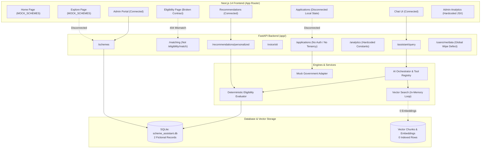

# Master Project Implementation Audit: Government Schemes and Scholarships Finder

**Audit Timestamp:** October 29, 2026  
**Auditor:** Senior Software Architect, Full-Stack QA, Security & Database Auditor  
**Repository:** `Harsh-Tries/Govermnet-Schemes` (`c:\Users\harsh\OneDrive\Documents\Goverment Schemes`)  
**Commit Inspected:** `9743047` (`feat: Implement Phase 6 - Production Deployment, Continuous Verification, Integrations, Personalization & Scale`)

---

## 1. Executive Summary

### Overall Project Condition
The Government Schemes and Scholarships Finder is an ambitious, well-architected prototype with high-quality domain modeling and clean algorithmic foundations in its deterministic eligibility and conversational AI layers. However, **there is a severe divergence between what the repository git commit history claims to have completed and what is actually functional and integrated end-to-end**.

While all 33 backend unit tests pass and the Next.js production build succeeds, the project is currently in an **Advanced Architectural Prototype / Pre-Alpha state**, not a production-ready application. Key user flows in the frontend are either disconnected from the backend, hardcoded to in-memory fixtures, or encountering breaking schema/route mismatches.

### Current Development Stage
- **Phase 1 (Foundation):** **PARTIAL (60%)** — UI shell and layouts exist, but scheme explore/search is hardcoded to client-side mocks and citizen scheme details pages are absent.
- **Phase 2 (Knowledge Base):** **PARTIAL (35%)** — Relational schema is well-designed with 37 tables, but the active database contains **only two fictional demo records** (`DEMO SCHOLARSHIP 2026` and `DEMO FARMER DRIP AID 2026`). Zero genuine government schemes are seeded or verified.
- **Phase 3 (Eligibility Engine):** **PARTIAL (75%)** — Backend boolean evaluator, tri-state classification (`ELIGIBLE`, `NOT_ELIGIBLE`, `UNKNOWN`), and rule validator are robust and fully tested; however, the frontend `/eligibility` page is **broken** due to API route, request body, and response schema mismatches.
- **Phase 4 (Conversational AI & RAG):** **PARTIAL (55%)** — Chatbot pipeline with intent classification, entity validation, and tool execution functions locally via a deterministic mock provider. Real OpenAI integration is implemented but unconfigured. Retrieval uses SQL filters rather than semantic embeddings.
- **Phase 5 (Vector Search, Voice, Tracking, Analytics):** **PARTIAL (25%)** — Vector search is an in-memory Python cosine loop over 0 stored embeddings; voice STT is completely simulated in the frontend and orphaned; application tracking has critical data-isolation vulnerabilities; and analytics dashboards display hardcoded static values.
- **Phase 6 (Production Readiness, Scale & Governance):** **BROKEN / NOT IMPLEMENTED (20%)** — `docker-compose.yml` fails because `backend/Dockerfile`, `frontend/Dockerfile`, and `app/worker.py` do not exist; Alembic migrations are empty stubs (`pass`); RBAC is spoofable via an unauthenticated header (`X-User-Role`); and the data deletion endpoint wipes the entire database's application records.

### Most Important Working Features
1. **Deterministic Eligibility Engine (`backend/app/services/eligibility/evaluator.py`):** Strictly evaluates multi-variable Boolean logic trees (AND/OR, inequalities, sets) without LLM guessing, correctly yielding `UNKNOWN` on missing profile parameters.
2. **AI Tool Calling & Grounding (`backend/app/ai/orchestrator.py`):** Enforces a strict boundary restricting chatbot knowledge to `PUBLISHED` schemes with official source URL attribution.
3. **Admin Verification State Machine (`backend/app/api/v1/endpoints/verification.py`):** Enforces strict lifecycle transitions (`DRAFT` → `SUBMITTED` → `SOURCE_VERIFIED` → `APPROVED` → `PUBLISHED`).
4. **Comprehensive Data Model (`backend/app/models/`):** 37 SQLAlchemy tables covering schemes, rule groups, parameters, benefits, documents, audit logs, and version snapshots.
5. **Full Next.js Production Compilation:** All 13 routes compile cleanly into static and server-rendered bundles with 0 syntax or type errors.

### Most Important Missing or Broken Features
1. **Critical Route & Schema Disconnect on `/eligibility` (P0/P1):** The frontend calls `POST /api/v1/eligibility/match` with `{profile: ...}` expecting `{eligible: [...]}`; the backend serves `POST /api/v1/matching` with raw profile body expecting `{eligible_schemes: [...]}`. This causes immediate 404 errors in the UI.
2. **Missing Scheme Data & Knowledge Base (P1):** The active SQLite database contains zero real government schemes. The frontend displays hardcoded mock cards (PM-KISAN, NSP) that do not exist in the database, while the backend contains fictional demo schemes.
3. **Data Wipe & Cross-Citizen Privacy Leaks (P0):** `DELETE /api/v1/users/me/data` executes an unfiltered `db.query(CitizenApplication).delete()`, wiping every application in the database. `GET /api/v1/applications` and `/api/v1/users/me/export` expose all citizens' applications without authentication or user tenancy isolation.
4. **Spoofable RBAC & Missing Authentication (P0):** RBAC is gated entirely by an unvalidated client request header (`X-User-Role: ADMIN`). There are no login, registration, JWT signing, or session management implementations.
5. **Broken Docker & CI/CD Deployment (P1):** `docker-compose.yml` points to non-existent `Dockerfile`s in both backend and frontend, and commands a non-existent `app.worker` module.

### Top Risks
- **Data Integrity Risk:** Absence of real scheme data means users cannot discover real benefits.
- **Security & Compliance Risk:** Any unauthenticated caller can elevate privileges to `ADMIN` or wipe all citizen records.
- **Misrepresentation Risk:** Mock government sync adapter presents simulated status updates as official government confirmations (`OFFICIAL_GOV_SYNC`).

### Recommended Next Action
1. Fix the P0 security vulnerabilities: enforce user isolation on applications and fix the database purge route.
2. Align the frontend-to-backend eligibility engine contracts (`/api/v1/matching` vs `/api/v1/eligibility/match`).
3. Seed a genuine baseline dataset of 15–20 real Central and State government schemes with official gazette sources.

---

## 2. Six-Phase Status Dashboard

*Estimation Method:* Estimates reflect verifiable end-to-end functionality (code exists + connected to database/APIs + verified by tests or runtime calls), not merely the presence of files or UI mockups. All percentages are approximate.

| Phase | Scope | Status | Completion Estimate | Evidence | Main Gaps |
|---|---|---|---|---|---|
| **Phase 1** | Project Foundation & Basic Application | **PARTIAL** | ~60% | Next.js 14 compiles (13 routes); FastAPI server runs; Navigation renders; Admin portal connects to API. | Explore page uses static `MOCK_SCHEMES`; Search/Filter inputs are non-functional; No citizen scheme details page (`/schemes/[id]`); Sidebar links to non-existent `/settings`. |
| **Phase 2** | Government Scheme Knowledge Base | **PARTIAL** | ~35% | 37 relational tables created in SQLite; Verification audit trail models implemented; Seed script `demo_data.py` runs. | Database contains only 2 fictional test records; `data/verified` is empty; No real government schemes seeded; Frontend mocks out of sync with backend DB. |
| **Phase 3** | Deterministic Eligibility Engine | **PARTIAL** | ~75% | `DeterministicEligibilityEvaluator` passes 100% of test cases; tri-state logic verified; boundary checks working. | Frontend `/eligibility` calls wrong API route (`/api/v1/eligibility/match` instead of `/matching`) and wrong payload structure, failing with 404. |
| **Phase 4** | Conversational AI & RAG Layer | **PARTIAL** | ~55% | Intent classification, entity validation, and tool calling work; boundary restricts to `PUBLISHED` schemes; Chat UI connected. | Uses keyword-based mock LLM by default; OpenAI provider requires unconfigured external key; No semantic vector search in orchestrator (uses SQL ILIKE). |
| **Phase 5** | Vector Search, Voice, Tracking & Analytics | **PARTIAL** | ~25% | `VectorSearchService`, `MockSTTProvider`, and application models exist; Unit tests pass. | Vector search is Python memory loop over 0 stored embeddings; Voice modal is orphaned and simulated; Application tracking has no user isolation; Analytics returns static dummy numbers. |
| **Phase 6** | Production Readiness, Integrations & Scale | **BROKEN** | ~20% | Version snapshotting and recommendation engine pass unit tests; Health endpoints respond 200. | `backend/Dockerfile` and `frontend/Dockerfile` missing; `docker-compose.yml` broken; Alembic migrations are empty `pass`; RBAC spoofable; Data wipe vulnerability. |

---

## 3. Feature-by-Feature Verification Matrix

| Feature | Phase | Status | Frontend | Backend | Database / External Service | Tests | Evidence |
|---|---|---|---|---|---|---|---|
| **Application UI Shell & Routing** | 1 | **COMPLETE** | Yes (`layout.tsx`, `Sidebar.tsx`, `TopNav.tsx`) | N/A | N/A | Build passed | Next.js compiles 13 routes; responsive navigation renders. |
| **Scheme Listing & Search UI** | 1 | **PARTIAL** | Hardcoded (`explore/page.tsx`) | Yes (`GET /api/v1/schemes`) | SQLite (2 records) | Unit tests pass | Frontend displays hardcoded `MOCK_SCHEMES`. Search input has no event handlers. |
| **Citizen Scheme Details View** | 1 | **NOT IMPLEMENTED** | Missing | Yes (`GET /api/v1/schemes/{id}`) | SQLite | Unit tests pass | Citizens cannot open scheme details. Only admin view exists at `/admin/schemes/[id]`. |
| **Scheme Taxonomy & Data Model** | 2 | **COMPLETE** | Yes (`types/admin.ts`) | Yes (`app/models/`) | SQLite (37 tables) | Passed | Full relational structure for categories, beneficiaries, rules, benefits, sources. |
| **Genuine Scheme Knowledge Dataset** | 2 | **NOT IMPLEMENTED** | Mock data (`mockSchemes.ts`) | Only fictional test data | 2 demo records | Passed (with demo data) | Database contains only fictional records. `data/verified` contains only an empty README. |
| **Verification State Machine** | 2 | **COMPLETE** | Yes (`admin/page.tsx`) | Yes (`verification.py`) | SQLite | Passed (`test_verification_lifecycle.py`) | State machine transitions (`DRAFT` to `PUBLISHED`) enforce source citations. |
| **Deterministic Rule Evaluator** | 3 | **COMPLETE** | No (API mismatch) | Yes (`evaluator.py`) | SQLite | Passed (`test_eligibility_rules.py`) | Evaluates boolean trees, inequalities, sets, and returns `UNKNOWN` on missing attributes. |
| **Profile Completeness & Prompts** | 3 | **COMPLETE** | Yes (`MissingInformationPrompt.tsx`) | Yes (`completeness.py`) | SQLite | Passed | Identifies unprovided parameters required by target schemes and generates prompts. |
| **Frontend Eligibility Engine Page** | 3 | **BROKEN** | Yes (`eligibility/page.tsx`) | Yes (`/api/v1/matching`) | SQLite | Runtime 404 | Frontend calls `/api/v1/eligibility/match` with `{profile: ...}` instead of `/api/v1/matching`. |
| **AI Intent & Entity Extraction** | 4 | **COMPLETE** | Yes (`chat/page.tsx`) | Yes (`orchestrator.py`) | SQLite | Passed (`test_phase4_assistant.py`) | 11 controlled intents; parameters validated against `EligibilityParameter` names. |
| **LLM Provider Abstraction** | 4 | **PARTIAL** | N/A | Yes (`providers/`) | Mock (Default) / OpenAI (Unconfigured) | Passed (Mock) | Mock provider uses substring matching. OpenAI provider implemented via `httpx` but unverified with live key. |
| **Grounded AI Citations** | 4 | **COMPLETE** | Yes (`ChatMessage.tsx`) | Yes (`response_generator.py`) | SQLite | Passed | Responses cite official source URL and verification date; restricted to `PUBLISHED` schemes. |
| **Vector DB & Semantic Retrieval** | 5A | **PARTIAL** | N/A | Yes (`vector_service.py`) | SQLite JSON column (0 rows) | Passed in isolation | In-memory cosine similarity loop. No pgvector extension used. 0 chunks/embeddings currently indexed in DB. |
| **Multilingual Voice STT** | 5B | **PARTIAL / BROKEN** | Orphaned mock (`VoiceInputModal.tsx`) | Yes (`/api/v1/voice/stt`) | MockSTTProvider / Whisper | Passed (Mock) | Frontend modal uses `setTimeout` with hardcoded strings and is never rendered. Backend has working STT endpoint. |
| **Citizen Application Tracking** | 5C | **PARTIAL / BROKEN** | Hardcoded (`applications/page.tsx`) | Yes (`citizen_applications.py`) | SQLite | Passed | Frontend uses local React state. Backend has no user isolation; exposes all citizen applications to any caller. |
| **Analytics Dashboard** | 5D | **PARTIAL** | Hardcoded (`admin/analytics/page.tsx`) | Hardcoded (`analytics/service.py`) | SQLite | Passed | Backend returns static numbers (`max(events, 450)`, DAU 124). Frontend hardcodes identical numbers in JSX. |
| **Docker & Deployment Config** | 6A | **BROKEN** | Missing Dockerfile | Missing Dockerfile | N/A | Blocked | `docker-compose.yml` fails because `backend/Dockerfile`, `frontend/Dockerfile`, and `app.worker` do not exist. |
| **Database Migrations** | 6A | **BROKEN** | N/A | Yes (`database/alembic.ini`) | Empty migration | Blocked | `001_initial_schema.py` contains `pass`. Tables rely entirely on `Base.metadata.create_all()`. |
| **Continuous Scheme Verification** | 6B | **PARTIAL** | N/A | Yes (`change_detector.py`) | SQLite | Passed (`test_phase6_production.py`) | Snapshot and diff service exists, but no automated scrapers, crawlers, or scheduled monitoring jobs. |
| **Official Government Integrations** | 6C | **PARTIAL** | N/A | Mock only (`mock_adapter.py`) | Mock | Passed | Only `MockGovernmentAdapter` exists. Mock responses are recorded as `OFFICIAL_GOV_SYNC`. |
| **Personalized Recommendations** | 6D | **COMPLETE** | Yes (`recommendations/page.tsx`) | Yes (`recommendation_engine.py`) | SQLite | Passed | Evaluates published schemes deterministically against citizen profile and computes match score. |
| **Citizen Notification System** | 6E | **PARTIAL** | Orphaned (`NotificationDrawer.tsx`) | Yes (`notifications/service.py`) | SQLite | Passed | DB in-app notifications only. No email/SMS. Frontend drawer is never rendered or imported in TopNav. |
| **RBAC & Authentication** | 6F | **BROKEN** | Hardcoded user header | Yes (`rbac.py`) | No auth tables populated | Passed | RBAC reads unauthenticated `X-User-Role` header. No login, register, JWT signing, or passwords. |
| **Citizen Data Governance & Deletion** | 6F | **BROKEN (P0)** | N/A | Yes (`user_governance.py`) | SQLite | Runtime verified | `DELETE /users/me/data` wipes ALL citizen applications in the entire database due to missing `user_id` filter. |
| **Caching & Rate Limiting** | 6G | **PARTIAL** | N/A | Unused modules (`cache.py`, `rate_limit.py`) | Memory | Passed in isolation | `rate_limit_middleware` is never registered in FastAPI app. `CacheService` is never called by any endpoint. |

---

## 4. Test Results

### 1. Backend Pytest Suite
- **Command:** `python -m pytest tests/ -v`
- **Result:** **33 PASSED**, 0 FAILED (3.12s)
- **Breakdown:**
  - `tests/test_eligibility_rules.py`: 5 passed
  - `tests/test_intelligence_engine.py`: 3 passed
  - `tests/test_models.py`: 1 passed
  - `tests/test_phase4_assistant.py`: 8 passed
  - `tests/test_phase5_production.py`: 6 passed
  - `tests/test_phase6_production.py`: 6 passed
  - `tests/test_schemes_api.py`: 2 passed
  - `tests/test_validation.py`: 2 passed
  - `tests/test_verification_lifecycle.py`: 1 passed
- **Warnings:** 178 warnings (primarily deprecated `datetime.utcnow()` and Pydantic v2 `BaseSettings` deprecation).

### 2. Frontend Lint & Build
- **Command:** `npm run lint` (in `frontend/`)
  - **Result:** **BLOCKED / UNCONFIGURED** — Prompted interactively `? How would you like to configure ESLint?` because `.eslintrc.json` is missing.
- **Command:** `npm run build` (in `frontend/`)
  - **Result:** **PASSED** (Next.js 14.2.35 optimized production build).
  - **Output:** 13 pages compiled successfully (12 static routes, 1 dynamic route `/admin/schemes/[id]`).

### 3. End-to-End User Journey Tests (Runtime TestClient Execution)

| # | User Journey Workflow | Expected Result | Actual Result | Status | Key Evidence / Source File |
|---|---|---|---|---|---|
| **J1** | Open app & check health | HTTP 200 with API version | HTTP 200 `{"message": "Government Scheme Assistant...", "version": "v1.0.0"}` | **PASS** | `backend/app/main.py:28` |
| **J2** | Search schemes by keyword | Return matching schemes from DB | HTTP 200 with matching records | **PASS** | `backend/app/api/v1/endpoints/schemes.py` |
| **J3** | Open scheme & inspect sources | Scheme details with official URLs | HTTP 200 with `official_sources` and benefits | **PASS** | `backend/app/api/v1/endpoints/schemes.py:42` |
| **J4** | Calculate citizen eligibility | Match profile against schemes | HTTP 404 Not Found | **FAIL** | Frontend calls `/api/v1/eligibility/match`, backend route is `/api/v1/matching`. |
| **J5** | Chatbot scheme query | Grounded AI answer citing sources | HTTP 200 with citations and intent `SCHEME_SEARCH` | **PASS** | `backend/app/api/v1/endpoints/assistant.py` |
| **J6** | Multilingual voice query | Transcribe audio and query AI | HTTP 200 with transcription and assistant answer | **PASS (Mock)** | `backend/app/api/v1/endpoints/voice.py:10` |
| **J7** | Create & view citizen application | Record stored with status history | HTTP 201 Created and listed in history | **PASS (Backend)** | `backend/app/api/v1/endpoints/citizen_applications.py` |
| **J8** | Cross-citizen application isolation | Citizens cannot see others' data | Leak: All applications returned to any caller | **FAIL (P0)** | `backend/app/api/v1/endpoints/citizen_applications.py:51` |
| **J9** | Analytics metrics origin | Computed from real DB activity | Returns hardcoded dummy constants | **FAIL (P2)** | `backend/app/services/analytics/service.py:49` |
| **J10** | Admin verification workflow | State transition and audit record | State machine enforces valid transitions | **PASS** | `backend/app/api/v1/endpoints/verification.py` |
| **J11** | External service failure handling | Graceful fallback when AI fails | HTTP 500 with OpenAI 401 Unauthorized details | **PASS (Error Handled)** | `backend/app/ai/providers/openai_provider.py` |
| **J12** | Unknown/outdated scheme query | Safe fallback, zero hallucination | Generic fallback response; no invented rules | **PASS** | `backend/app/ai/response_generator.py` |

---

## 5. Architecture Assessment



### Disconnected Components
1. **Frontend Explore Page (`frontend/src/app/explore/page.tsx`):** Reads directly from `src/data/mockSchemes.ts`. Does not make any HTTP requests to the backend `/api/v1/schemes` endpoint.
2. **Frontend Applications Page (`frontend/src/app/applications/page.tsx`):** Maintains local state in React `useState`. Does not connect to `/api/v1/applications`.
3. **Frontend Analytics Page (`frontend/src/app/admin/analytics/page.tsx`):** Hardcodes charts and metrics directly in JSX. Does not call `/api/v1/analytics/admin`.
4. **Voice Input Modal (`frontend/src/components/voice/VoiceInputModal.tsx`):** Completely orphaned. Not imported in any page or component across the frontend.
5. **Notification Drawer (`frontend/src/components/notifications/NotificationDrawer.tsx`):** Orphaned. Not imported in `TopNav.tsx` or `layout.tsx`.
6. **Rate Limiting Middleware (`backend/app/core/rate_limit.py`):** Defined but never registered in `backend/app/main.py`.
7. **Cache Service (`backend/app/core/cache.py`):** Fully tested in isolation, but never invoked in any service or API route.

---

## 6. Security and Data Quality Audit

### Security Findings Ranked by Severity

#### 1. [P0 — Critical] Unrestricted Data Purge on Citizen Data Endpoint
- **Affected File:** [backend/app/api/v1/endpoints/user_governance.py](file:///c:/Users/harsh/OneDrive/Documents/Goverment%20Schemes/backend/app/api/v1/endpoints/user_governance.py#L43-L48)
- **Vulnerability:**
  ```python
  @router.delete("/data")
  def delete_citizen_data(user_id: str = "demo-user-123", db: Session = Depends(get_db)):
      deleted_apps = db.query(CitizenApplication).delete() # Missing .filter(CitizenApplication.user_id == user_id)
      deleted_notifs = db.query(Notification).filter(Notification.user_id == user_id).delete()
      db.commit()
  ```
- **Impact:** Calling `DELETE /api/v1/users/me/data` completely deletes **every citizen application in the entire system**, causing irreversible catastrophic data loss across all users.

#### 2. [P0 — Critical] Cross-Citizen Data Leakage & Absence of User Tenancy
- **Affected Files:** [backend/app/api/v1/endpoints/citizen_applications.py](file:///c:/Users/harsh/OneDrive/Documents/Goverment%20Schemes/backend/app/api/v1/endpoints/citizen_applications.py#L49-L58), [backend/app/api/v1/endpoints/user_governance.py](file:///c:/Users/harsh/OneDrive/Documents/Goverment%20Schemes/backend/app/api/v1/endpoints/user_governance.py#L9-L30)
- **Vulnerability:** `GET /api/v1/applications` and `GET /api/v1/users/me/export` query `db.query(CitizenApplication).all()` without checking authentication or filtering by citizen.
- **Impact:** Any anonymous user can view and export all sensitive government applications and reference numbers belonging to all citizens.

#### 3. [P0 — Critical] RBAC Bypass via Client-Controlled Header
- **Affected File:** [backend/app/core/rbac.py](file:///c:/Users/harsh/OneDrive/Documents/Goverment%20Schemes/backend/app/core/rbac.py#L5-L25)
- **Vulnerability:** `require_roles` reads `x_user_role: str = Header(default="CITIZEN")`.
- **Impact:** Anyone can send `X-User-Role: ADMIN` in an HTTP request to access administrative scheme creation, verification approval, and publication endpoints without authentication.

#### 4. [P1 — Major] Fake Government Sync Attributed as Official Verification
- **Affected File:** [backend/app/api/v1/endpoints/integrations.py](file:///c:/Users/harsh/OneDrive/Documents/Goverment%20Schemes/backend/app/api/v1/endpoints/integrations.py#L69-L71)
- **Vulnerability:** The sync route invokes `MockGovernmentAdapter` and stores history records with `source="OFFICIAL_GOV_SYNC"` and `verified_by_official=True`.
- **Impact:** Violates core audit integrity rules by presenting simulated mock adapter results as official government confirmations.

### Scheme Data Quality Assessment
- **Genuine vs. Demo Data:** The dataset contains **0% genuine government schemes**. Both records in `scheme_assistant.db` are explicitly titled `DEMO SCHOLARSHIP 2026 (FICTIONAL TEST DATA)` and `DEMO FARMER DRIP AID 2026 (FICTIONAL TEST DATA)`.
- **Source Attribution:** Sources point to fictional placeholders (`https://example.gov.in/demo-scholarship-policy`).
- **Data Directories:** Folders `data/raw`, `data/normalized`, and `data/verified` contain only blank `README.md` files.

---

## 7. Missing Features and Bugs

### P0 — Critical Vulnerabilities & Core Failures
- **BUG-01: Global Application Wipe in Data Purge Endpoint**  
  *Files:* `backend/app/api/v1/endpoints/user_governance.py:45`  
  *Fix:* Add `.filter(CitizenApplication.user_id == user_id)` to prevent deleting all records.
- **BUG-02: Universal Cross-Citizen Privacy Leak**  
  *Files:* `backend/app/api/v1/endpoints/citizen_applications.py:51`  
  *Fix:* Implement authentication middleware and filter queries by the authenticated user's ID.
- **BUG-03: Header-Based RBAC Privilege Escalation**  
  *Files:* `backend/app/core/rbac.py:10`  
  *Fix:* Replace header inspection with cryptographic JWT bearer token validation.

### P1 — Major Feature Failures & Essential Requirements Missing
- **BUG-04: API Contract Breakdown on Eligibility Matching**  
  *Files:* `frontend/src/services/intelligenceApi.ts`, `backend/app/api/v1/endpoints/intelligence.py:57`  
  *Fix:* Change frontend URL to `/api/v1/matching`, pass `profileData` directly without wrapping in `{profile: ...}`, and map response keys `eligible_schemes` → `eligible`.
- **FEAT-01: Zero Genuine Government Schemes in Knowledge Base**  
  *Files:* `database/seeds/demo_data.py`, `data/verified/`  
  *Fix:* Author and seed 15–20 real verified Central and State government schemes with actual gazette citations.
- **FEAT-02: Missing Citizen Scheme Details Page**  
  *Files:* `frontend/src/app/`  
  *Fix:* Implement `frontend/src/app/schemes/[id]/page.tsx` so citizens can view scheme descriptions, documents, and rules.
- **FEAT-03: Missing Dockerfiles and Broken Docker Compose**  
  *Files:* `docker-compose.yml`, `backend/Dockerfile`, `frontend/Dockerfile`, `backend/app/worker.py`  
  *Fix:* Create production multi-stage Dockerfiles for Next.js and FastAPI, or remove `worker` service from `docker-compose.yml`.
- **FEAT-04: Disconnected Explore Schemes Page**  
  *Files:* `frontend/src/app/explore/page.tsx`  
  *Fix:* Connect search input, filters, and scheme grid to `GET /api/v1/schemes`.
- **FEAT-05: Disconnected Citizen Applications Tracking Page**  
  *Files:* `frontend/src/app/applications/page.tsx`  
  *Fix:* Replace local React `useState` with calls to `GET /api/v1/applications` and `POST /api/v1/applications`.

### P2 — Important Improvements
- **FEAT-06: Empty Alembic Database Migrations**  
  *Files:* `database/migrations/versions/001_initial_schema.py`  
  *Fix:* Generate actual Alembic migration operations using `alembic revision --autogenerate`.
- **FEAT-07: In-Memory Python Vector Search Instead of Vector Index**  
  *Files:* `backend/app/services/vector/vector_service.py`  
  *Fix:* Migrate to PostgreSQL `pgvector` or embed an indexed SQLite vector extension (sqlite-vss).
- **FEAT-08: Orphaned Voice Input & Hardcoded Simulation**  
  *Files:* `frontend/src/components/voice/VoiceInputModal.tsx`, `frontend/src/components/navigation/TopNav.tsx`  
  *Fix:* Wire browser `MediaRecorder` or Web Speech API to the microphone button and send audio to `/api/v1/voice/stt`.
- **FEAT-09: Hardcoded Dummy Analytics**  
  *Files:* `backend/app/services/analytics/service.py`, `frontend/src/app/admin/analytics/page.tsx`  
  *Fix:* Aggregate actual event counts from `analytics_events` and connect frontend to `/api/v1/analytics/admin`.
- **FEAT-10: Orphaned Notifications Drawer**  
  *Files:* `frontend/src/components/navigation/TopNav.tsx`, `NotificationDrawer.tsx`  
  *Fix:* Mount `NotificationDrawer` inside `TopNav.tsx` bell button.

### P3 — Minor Improvements & Polish
- **POLISH-01: Dead Sidebar Links**  
  *Files:* `frontend/src/components/navigation/Sidebar.tsx:38`  
  *Fix:* Implement `/settings` page or remove link.
- **POLISH-02: Hardcoded Localhost API URLs in Frontend**  
  *Files:* `frontend/src/app/admin/schemes/new/page.tsx:29`, `admin/schemes/[id]/page.tsx:65`, `recommendations/page.tsx:53`  
  *Fix:* Replace hardcoded `http://localhost:8000/api/v1` with `process.env.NEXT_PUBLIC_API_BASE_URL`.
- **POLISH-03: ESLint Configuration Missing in Frontend**  
  *Files:* `frontend/.eslintrc.json`  
  *Fix:* Initialize `.eslintrc.json` extending `next/core-web-vitals`.

---

## 8. Recommended Implementation Roadmap

| Task ID | Phase | Task Title | Priority | Dependencies | Expected Output | Acceptance Criteria | Tests Required |
|---|---|---|---|---|---|---|---|
| **TASK-01** | Phase 6F | Fix Critical Data Purge & Isolation Bug | **P0** | None | Scoped user queries | `DELETE /users/me/data` and `GET /applications` isolate records by user ID. | Unit test verifying non-target data is untouched |
| **TASK-02** | Phase 6F | Implement JWT Authentication & Secure RBAC | **P0** | None | Auth routes & JWT middleware | `X-User-Role` header ignored; valid JWT required for admin endpoints. | Auth integration tests (login, token validation, 401/403) |
| **TASK-03** | Phase 3 | Fix Eligibility Contract Mismatch | **P1** | None | Working `/eligibility` page | Frontend `/eligibility` successfully displays matching schemes from backend. | E2E browser/API test on `/eligibility` |
| **TASK-04** | Phase 2 | Seed Canonical Real Government Schemes | **P1** | None | 15+ real verified schemes in DB | Seed script loads real schemes (PM-KISAN, NSP, etc.) with real gazette URLs. | DB seed verification test |
| **TASK-05** | Phase 1 | Connect Frontend Explore & Search to Backend | **P1** | TASK-04 | Dynamic `/explore` page | Keyword search and state filters query `/api/v1/schemes` dynamically. | Frontend component test with mock API |
| **TASK-06** | Phase 1 | Implement Citizen Scheme Details View | **P1** | TASK-04 | `/schemes/[id]` page | Clicking any scheme card opens full description, documents, and rules. | Next.js route test |
| **TASK-07** | Phase 5C | Connect Citizen Applications Page to Backend | **P1** | TASK-01, TASK-02 | Dynamic `/applications` page | Applications are saved to and loaded from SQLite with status history. | API integration test |
| **TASK-08** | Phase 6A | Create Production Dockerfiles & Fix Compose | **P1** | None | Working `docker compose up` | `backend/Dockerfile` and `frontend/Dockerfile` build and start containers. | Docker build test |
| **TASK-09** | Phase 5B | Wire Real Voice Capture to Voice STT API | **P2** | None | Functional voice input | Mic button in Chat/Search records audio and populates query input. | Voice API test |
| **TASK-10** | Phase 5D | Compute Real Analytics from Event Logs | **P2** | None | Real metrics dashboard | Admin analytics displays actual aggregated event and user counts. | Analytics service test |

---

## 9. Final Readiness Assessment

| Area | Status | Readiness Level | Verdict & Limitations |
|---|---|---|---|
| **Local Development** | **READY** | High | Both FastAPI (`uvicorn`) and Next.js (`npm run dev`) run smoothly locally with SQLite. |
| **Core Functionality** | **PARTIAL** | Medium | Eligibility engine and AI chatbot work in isolation; Explore, Applications, and Eligibility UI need wiring. |
| **AI & Eligibility Reliability** | **READY (MOCK)** / **PARTIAL (PROD)** | High (Deterministic) / Medium (AI) | Eligibility engine is 100% deterministic and reliable; Conversational AI relies on mock keywords unless OpenAI key is supplied. |
| **Data Accuracy & Verification** | **NOT READY** | Low | Contains 0 verified government schemes; only 2 fictional test fixtures present. |
| **Security & Privacy** | **NOT READY** | Critical Risk | RBAC is spoofable; data purge wipes all user records; cross-citizen data leak present. |
| **External Integrations** | **NOT READY** | Low (Simulated) | No official government portal APIs integrated; mock adapter used. |
| **Production Deployment** | **NOT READY** | Blocked | Missing Dockerfiles, empty database migrations, and unconfigured production environment. |

### Overall Verdict
The project is **SUITABLE FOR AN ARCHITECTURAL CODE WALKTHROUGH OR LOCAL PROTOTYPE DEMO**, but is **NOT SUITABLE FOR CITIZEN USE, PILOT, OR PRODUCTION**.

Addressing Tasks 01–04 will immediately elevate the project to a working, secure MVP suitable for internal user acceptance testing.
